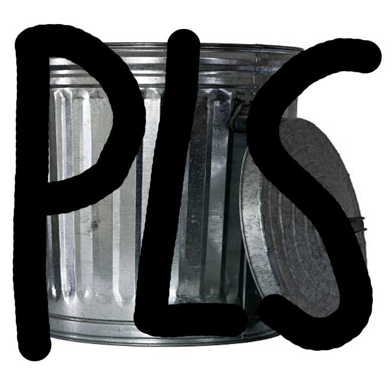

<p align="center">
  
</p>

<h1 align="center">pls-delete</h1>

<p align="center">
  A minimalist, fast native Windows GUI for <a href="https://learn.microsoft.com/en-us/sysinternals/downloads/sdelete">Sysinternals SDelete</a> to securely zero-fill free drive space (<code>-z</code>).
</p>

---

## English

### 🔒 Preparing a Drive for Sale (Prevent Data Recovery)
Deleting files or formatting a drive in Windows only clears the file index — your actual files remain fully recoverable with standard file-recovery software.

To securely prepare a drive before selling or giving it away so nobody can view or restore your previous files:
1. Delete your files or format the drive normally.
2. Run **pls-delete**, select the drive letter, and click **"Wipe Selected Drive"**.
3. The tool overwrites all free space with zeros (`-z`), making previous data permanently unrecoverable.

### Requirements & Setup
- Windows 10/11 (x64) with Administrator privileges.
- Place [`sdelete64.exe`](https://learn.microsoft.com/en-us/sysinternals/downloads/sdelete) in the same folder as `pls-delete.exe` (or in your system `PATH`).

### Build
```bash
cargo build --release
```

---

## Русский

### 🔒 Подготовка диска к продаже (защита от восстановления данных)
Обычное удаление файлов или быстрое форматирование диска в Windows лишь очищает оглавление файловой системы — сами файлы остаются на диске и легко восстанавливаются любой программой для восстановления данных.

Чтобы надежно подготовить накопитель к продаже или передаче другому человеку, исключив просмотр и восстановление ваших личных файлов:
1. Удалите файлы или отформатируйте диск обычным способом.
2. Запустите **pls-delete**, выберите нужный диск и нажмите **«Wipe Selected Drive»**.
3. Программа перезапишет всё свободное дисковое пространство нулями (`-z`), навсегда уничтожив следы удаленных файлов.

### Требования и запуск
- Windows 10/11 (x64) с правами администратора.
- Поместите [`sdelete64.exe`](https://learn.microsoft.com/en-us/sysinternals/downloads/sdelete) в одну папку с `pls-delete.exe` (или добавьте в системный `PATH`).

### Сборка
```bash
cargo build --release
```

---

## License
[MIT](LICENSE)
